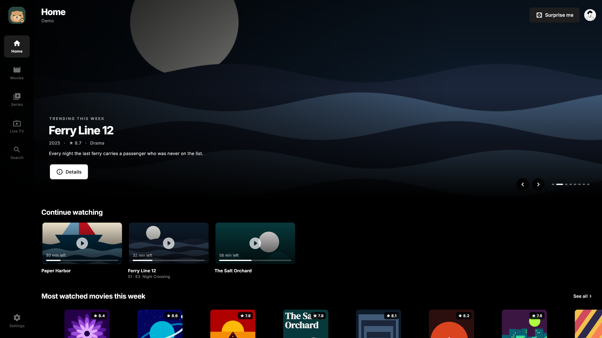

<div align="center">


# Capy TV

An open-source IPTV player for Android, Android TV and Fire TV, Windows, Linux and Samsung TVs,
with an optional end-to-end encrypted sync server you run yourself.

[](https://github.com/andresayac/capy-tv/actions/workflows/ci.yml)
[](LICENSE)

[Website](https://andresayac.github.io/capy-tv/) · [Download](https://github.com/andresayac/capy-tv/releases/latest)

</div>

Capy TV plays what **your own provider** gives you: an Xtream Codes account or an M3U list, with
its XMLTV guide. It ships with no channels, playlists or content of any kind.



## Highlights

- **Made for the couch.** The same app on a phone, a computer and a TV, driven by touch, mouse or
  remote. Your phone can type for the TV, act as its remote and move backups, by scanning a QR
  code, with no cloud in between.
- **Movies and series first.** Trending titles and their trailers, the week's most watched, new
  episodes of your series, *Surprise me*, and a movie night where everyone votes from their phone.
- **A complete player**, built on libmpv: multiple audio and subtitle tracks (image subtitles too),
  pausing and rewinding live TV, up to four channels at once, recordings now or scheduled from the
  guide, picture in picture, a sleep timer and skipping a series' intro.
- **Several providers as one.** Combine playlists; a title listed several times shows once, and
  plays from the copy that usually starts fastest at that hour, or from another when one fails.
- **Profiles for the family.** Kids profiles, a parental PIN, adult content hidden by default and a
  time per day.
- **Search that keeps up** with catalogs of tens of thousands of titles, forgiving typos and accents.
- **Your own sync server, optional.** Playlists, favorites and progress follow you across devices,
  encrypted on the device so the server cannot read them. It can also send what you watch to
  another device and keep the apps updated.
- **Chromecast** without Google Play Services, so Fire TV and Windows cast too (beta).
- **Recommendations** from any OpenAI-compatible language model, if you want them.

Everything in detail: [docs/features.md](docs/features.md) and [docs/player.md](docs/player.md).

## Platforms

| Platform | How to get it |
|---|---|
| Android phones and tablets (7.0 or later) | APK from [Releases](https://github.com/andresayac/capy-tv/releases) |
| Android TV, Google TV and Fire TV | The same APK (the 32-bit one for most TV boxes) |
| Windows 10 and 11 | Installer from [Releases](https://github.com/andresayac/capy-tv/releases) |
| Linux (x64, and arm64 such as a Raspberry Pi 4 or 5) | `.tar.gz` from [Releases](https://github.com/andresayac/capy-tv/releases); needs `libmpv2` |
| Samsung TVs (Tizen; used on 2020 and 2026 models) | `CapyTV.wgt` from [Releases](https://github.com/andresayac/capy-tv/releases), a web app of its own, installed from a computer: [tizen/README.md](tizen/README.md) |
| macOS and iOS | Build from source |

Step-by-step installation, with no programming: [docs/install.md](docs/install.md).

## Sync server

The server is optional: without it each device keeps its own playlists and progress. With it, a
family shares them across devices. It is a small Go program with SQLite, one Docker command with
automatic HTTPS, and it only ever stores encrypted data. See [server/README.md](server/README.md).

## Building from source

```sh
cd app
flutter pub get
flutter run -d windows        # or linux, macos, or an Android device id
```

Trending titles, posters and trailers need a free [TMDB](https://www.themoviedb.org) API key, given
at build time. Building the APKs and the installer, the tests, and how releases are made are covered
in [docs/development.md](docs/development.md).

## Project layout

| Path | What |
|---|---|
| [`app/`](app) | The Flutter app: one codebase for Android, Windows, Linux, macOS, iOS and the web |
| [`tizen/`](tizen) | The app for Samsung TVs, in TypeScript and Preact |
| [`server/`](server) | The optional sync server, in Go |
| [`site/`](site) | The project's web page, in Astro |
| [`docs/`](docs) | Installation, features, the player, development and credits |
| [`tools/`](tools) | An image proxy for developing the web version |

Built with [Flutter](https://flutter.dev) and [media_kit](https://github.com/media-kit/media-kit)
(libmpv). It speaks the Xtream Codes API (`player_api.php`), M3U playlists and XMLTV guides.

## Contributing

Issues and pull requests are welcome: see [CONTRIBUTING.md](CONTRIBUTING.md). To report a security
problem, see [SECURITY.md](SECURITY.md).

## License

[Mozilla Public License 2.0](LICENSE). Anyone may use, change and ship it, also inside other
products, as long as changes to these files are published under the same license. Third-party parts
and credits: [docs/credits.md](docs/credits.md).
